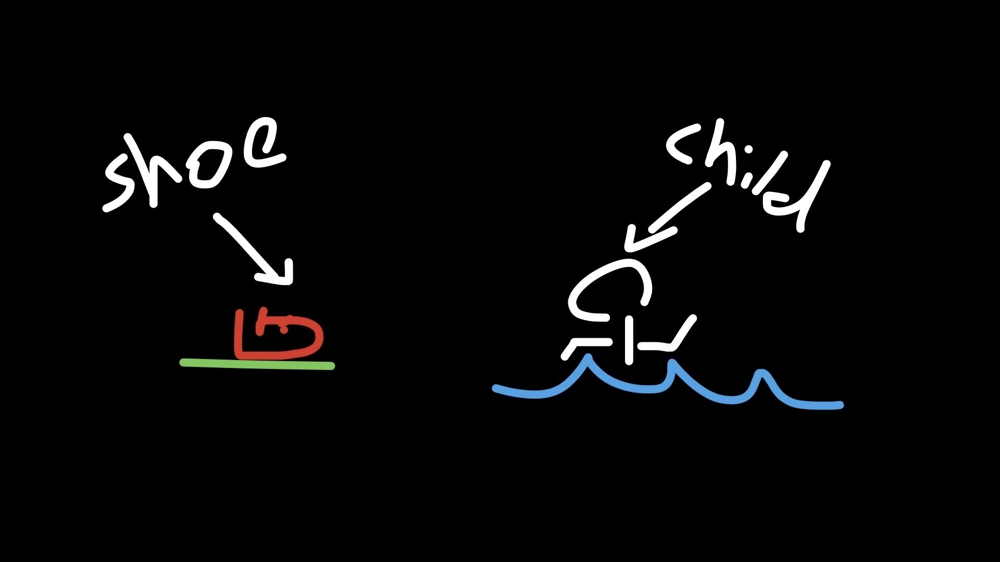

Ok this one is long and gets a bit philosophical, so bear with me.

Most people like to consider themselves fairly good people. Maybe they avoid buying form particularly unethical companies, recycle, eat less meat, or occasionally give to charity. Or maybe they’re just generous with friends, kind to strangers and try to go about life in an overall decent way. But how positive is our impact, really?

When it comes to consumption, most of us also spend money on things we don’t really need, fly to other countries for our own enjoyment, and own a pretty sizeable collection of possessions which we could quite comfortably live without. And while we tend to think of ethical consumption in terms of _what_ we buy, what it’s made form and how it’s sourced, arguably the much bigger ethical question is whether we should be buying most of these things at all.

Is it morally ok to spend £20 on a night out when that same £20 could be used to buy mosquito nets that would directly save people’s lives? And if it isn’t, are we genuinely just morally obligated to sell most of our possessions and give away all of our disposable income?
  

**The Drowning Child**

In his 1972 essay, philosopher Peter Singer proposed a now fairly well-known thought experiment. Imagine you’re walking past a shallow pond and notice a young child drowning. You could quite easily wade in and save them without putting yourself in any real danger, but doing so would ruin the nice clothes you’re wearing.

I think most people would agree that you have a moral obligation to save the child. If someone knowingly let a child drown because they didn’t want to ruin their £80 pair of shoes, we’d probably consider them a terrible person.

But what if, instead of being in the pond in front of you, the child is several thousand miles away? And instead of ruining a £80 pair of shoes to save them, you’re just choosing not to buy the shoes in the first place, and donating the money to an effective charity? Or even just not having £80 in your bank account?

Is there actually much of a moral difference between the two scenarios?

Of course, in donating there’s generally no guarantee that your £80 is going to save a specific child. But there absolutely are effective charities you can donate to, where there’s a very real chance that your money will directly save someone’s life, or at least contribute to doing so. And there’s certainly an argument to be made that this chance is worth considerably more than a nice pair of shoes.

Singer’s argument is essentially that if we can prevent something bad from happening without sacrificing something of comparable moral importance, we have a moral obligation to do so.
It definitely makes sense, but if you actually apply it consistently, its implications are pretty extreme.
  

**Are you morally obligated to sell all your possessions?**

Let’s go back to the £20 night out. £20 probably isn’t going to get you particularly far on a night out in London, but it could fund several insecticide-treated mosquito nets, potentially protecting multiple people from a deadly disease for years.

The problem with trying to morally justify the night out is that most of us would probably agree that the latter is a better use of the money. We might argue that we need to enjoy ourselves, or that socialising is important for our mental health, and both of these are entirely valid points. But is the enjoyment we’ll get from that particular £20 really of comparable importance to protecting several people from malaria?

And this same argument applies to pretty much everything we buy.

Do you need a new phone, or does your current one work well enough? Do you need to go abroad on holiday? Do you need a Netflix subscription, or could you entertain yourself for free? Do you even need to keep working the relatively enjoyable job you currently have, if you could earn considerably more doing something else and donate the difference?

It’s also worth pointing out that this argument doesn’t just apply to the wealthy. It’s very easy to criticise billionaires for spending millions on private yachts while people are starving, but a lot of the moral reasoning behind that criticism applies to our own spending too. Obviously the scale is wildly different, and an extra £20 has far more value to someone on an average salary than it does to a billionaire, but at what point do we consider someone wealthy enough that their spending on non-essentials becomes immoral?

And is there any real moral justification for that cut-off, or have we just drawn the line somewhere conveniently above our own level of wealth? To a homeless or starving person, someone with enough money to go out for drinks and pay for Netflix with a roof over their head is pretty much living in luxury.

Taken to its logical conclusion, Singer’s argument would mean selling most of what we own, living pretty frugally, and giving away our money until doing so would cause us suffering comparable to that which we’re trying to alleviate.

Interestingly though, this doesn’t necessarily mean selling literally _everything_. Keeping a laptop that allows you to work, investing in your education, or even spending money on things that keep you happy and motivated might ultimately allow you to do considerably more good over the course of your life. Giving away too much money and subsequently becoming dependent on other people obviously isn’t particular helpful either. 

Actually, trying to gain as much money as possible, leveraging exponential growth to later maximise your impact, would arguably become the most ethical thing to do. To the point where you could _maybe_ even argue for abusing workers or customers to some extent, if the wealth you build as a result ultimately results in a more positive impact overall. But either way, this still obligates you to never actually spent money on yourself, besides the essentials for a healthy and sustainable life – which is far beyond the money even most of us non-millionaires would ideally like to spend.
  

**Can you actually consume ethically?**

Even if we ignore the moral implications of what else our money could be used for, there’s the issue of the damage we directly or indirectly cause through our consumption.

If you want to minimise your impact on the environment, you could stop eating meat. But plant-based foods also have environmental impacts, whether through deforestation, water consumption, pesticide use, or the displacement of wildlife to create space agriculture.

You might buy an electric car to reduce your carbon emissions, but the mining of materials used to produce its battery has environmental and, in some cases, pretty concerning humanitarian implications, and actually that goes for your smartphone too. You could avoid buying a car altogether, but even the infrastructure used by public transport required huge quantities of resources to build and operate.

And then there’s the clothes we wear, the energy we use  to heat our homes, and so on. Even if you were willing to spend hours researching the supply chain of every single thing you bought, there often isn’t enough information available to make a completely informed decision anyway.

Even with a lot of products marketed as sustainable, in many cases the most environmentally friendly option is just not too buying them. A reusable water bottle is great if it stops you buying disposable plastic bottles, but if you already have a perfectly functional reusable bottle, buying a new, more sustainably manufactured one does more harm than just using a less eco-friendly one you already own.

None of this is to say that trying to consume ethically is pointless though. Obviously, there are varying degrees of harm associated with different products, and the fact that both options have some negative impact doesn’t make them morally equivalent. But it’s pretty difficult to see how you can consume or participate in society without causing harm. Even withdrawing from modern society entirely would have its own impacts.
  

**Where do you draw the line?**

So we’ve established it’s likely impossible to live without causing harm. And we’ve established there’s always more ethical ways to spend your money (and by extension, your time). So either you accept these conclusions and turn every waking moment into an effort to minimise suffering and maximise good. Or you choose somewhere to draw the line. 

A lot of this comes down to how you think about morality in general, and two key philosophical ideas in this context are utilitarianism and emotivism.

Utilitarianism is essentially the idea that the morality of an action is determined by its consequences in terms of overall positivity or goodness. Your own happiness does count in this, but it doesn't inherently count for more than anyone else's. So from a fairly strict utilitarian perspective, it's difficult to justify the harm from a lot of our consumption. Equally, it’s hard to justify spending money on non-essentials that bring a relatively small amount of happiness, if that money could be used to alleviate a considerable amount of suffering.

Emotivism, on the other hand, proposes that when we describe something as morally right or wrong, we're not stating an objective fact about it, but expressing a subjective attitude of approval or disapproval. Importantly, this doesn’t necessarily have to be consistent cross all situations. You might get a sense of ‘wrongness’ at the idea of allowing a child to drown to preserve your £80 shoes, but not an equivalent emotional reaction at the idea of someone spending £80 on themselves instead of donating to a life-changing charity.

The two theories aren’t actually mutually exclusive. Utilitarianism can still provide a framework for helping to decide what we ought to do, or to help us understand why we feel the way we do about a particular moral question. So you could subscribe to emotivism as an idea of what morality actually is, while still using utilitarianism to help guide your decisions or resolve uncertainties.

With emotivism, you can then say the distance and difference in immediacy between Singer’s drowning child and an unknown child at risk somewhere else in the world does actually make a difference. It isn’t as wrong to you purely because it doesn’t feel as wrong to you. It’s all down to your subjective experience of ‘wrongness’.

Having said that, just because a moral boundary feels right to us doesn't mean we shouldn't question it. Our moral intuitions are hugely influenced by the society we grow up in, what other people consider normal, and, probably quite substantially, what is convenient for us to believe.

Even if we don’t decide we need to literally maximise our money/time, and literally minimise all negative impact, there’s still value in considering what else the money we spend could be used for, and whether the things we buy bring us enough happiness to justify both their environmental or humanitarian impact. But I also think there’s value in travelling, having hobbies, going out with friends, and experiencing as much of the world as we can in the one life we have.

Soooo have a good think but, ultimately do what you want?

That might seem like a kind of nihilistic conclusion, but I would bet that what most people want is still to be kind to the people around them, and to make an effort to have a generally positive impact on the world – even if they don’t literally maximise towards that.

The important thing, I would say, is that you actually put some thought into where you draw it, rather than just letting your lifestyle dictate where it happens to fall.
  

**References:**

Peter Singer (1972), Famine, Affluence, and Morality: [https://terpconnect.umd.edu/\~dcrocker/Courses/Docs/Singer-Famine%20Affluence%20Morality.pdf](https://terpconnect.umd.edu/~dcrocker/Courses/Docs/Singer-Famine%20Affluence%20Morality.pdf)

Stanford Encyclopedia of Philosophy, Moral Cognitivism vs. Non-Cognitivism: [https://plato.stanford.edu/entries/moral-cognitivism/](https://plato.stanford.edu/entries/moral-cognitivism/)

GiveWell, Against Malaria Foundation: [https://www.givewell.org/charities/amf](https://www.givewell.org/charities/amf)
