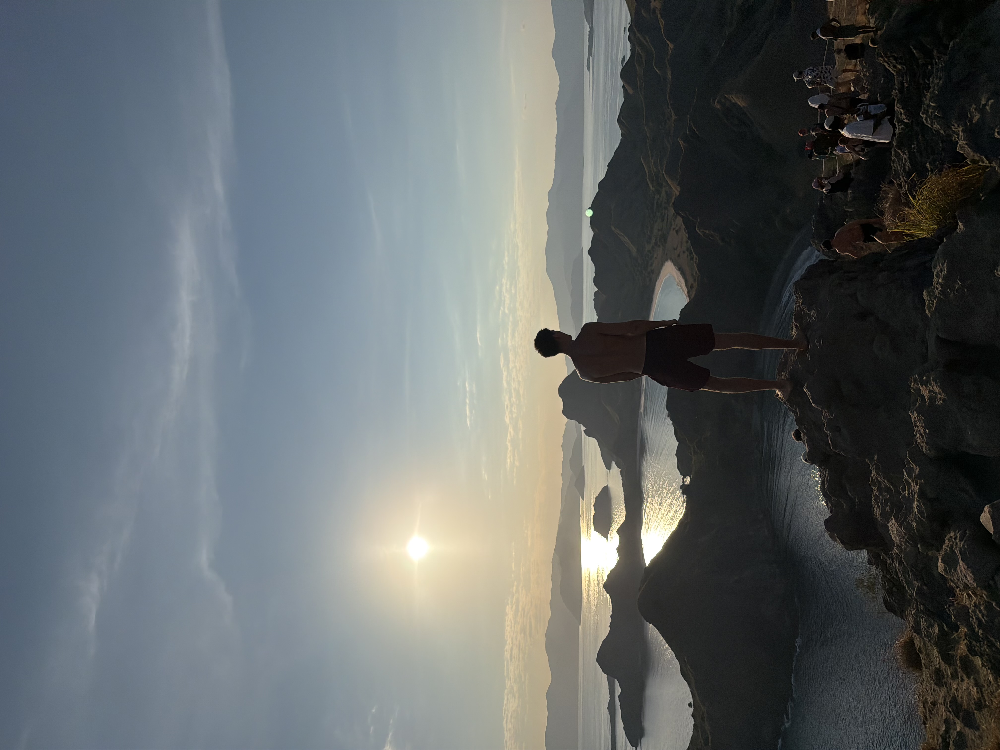

Swimming with whale sharks is pretty high on a lot of people's bucket lists, and understandably so. Whale sharks (or _rhincodon typus_ if you want to be all technical), are the largest fish in the world, and despite being capable of growing to over 12 metres in length, they feed predominantly on plankton and other small marine organisms, and pose very little danger to humans. They’re definitely more whale than shark in how they come across (although I would argue most sharks are pretty chill too).

Unfortunately, their popularity has led to some fairly questionable practices to make interactions with them more accessible and reliable, and a lot of supposedly ‘ethical’ excursions are a bit dodgy.
  

**What's wrong with feeding whale sharks?**

Whale sharks are naturally highly mobile animals, and travel thousands of kilometres in search of food. Providing them with a reliable source of food in one location can interfere with their natural movements, feeding habits, and potentially even reproductive behaviour.

It also encourages them to associate humans and boats with food, which isn't a particularly good association for an animal very vulnerable to boat strikes. Having said that, there are varying degrees of feeding, and big differences in how whale shark tourism operates around the world.
  

**Oslob, Philippines**

**Recommendation: Avoid**

Oslob is probably one of the first places you'll come across if you've looked into swimming with whale sharks. It's relatively inexpensive, easily accessible from other popular destinations in the Philippines, and sightings are pretty much guaranteed year-round.

Unfortunately, this is because local fishermen feed the sharks shrimp every morning, encouraging them to remain in a small area of shallow water while groups of tourists are brought in.

Oslob is one of the most studied whale shark tourism operations in the world, and researchers have found that:

- Some whale sharks have substantially extended their residency in the area, returning almost daily for months at a time
- Frequently fed sharks have altered their diving behaviour, spending more time in warmer, shallower water
- The sharks expend considerably more energy during tourism interactions
- Regulations around tourists getting too close to sharks are constantly broken

It's worth acknowledging that whale shark tourism has had a huge positive economic impact on the local community, providing alternative sources of income for fishermen. But given that there are several other places in the Philippines where you can swim with whale sharks without feeding them, I'd really struggle to recommend Oslob.
  

**Donsol, Philippines**

**Recommendation: Great alternative to Oslob**

**Best time to visit: February–April**

Turns out the Philippines actually had a much more responsible whale shark tourism industry before the one in Oslob even existed.

Whale shark tourism in Donsol began in 1998 with the help of WWF-Philippines, and operates around a natural seasonal aggregation of whale sharks feeding in the plankton-rich waters of Donsol Bay.

The sharks aren't fed, and instead boats head out with local spotters to find them. Only six tourists are supposed to swim with a shark at once, although there have been issues with overcrowding and compliance with regulations.

Of course, the lack of feeding means sightings aren't guaranteed, and the water tends to be a bit murkier than at other destinations. But since that a lot of that murkiness is the plankton the sharks are actually there to eat, that's actually a good indication that you're seeing them in the right sort of environment.
  

**Southern Leyte, Philippines**

**Recommendation: Great alternative to Oslob, potentially less crowds than Donsols**

**Best time to visit: November–May**

Another, considerably less well-known alternative to Oslob is Sogod Bay, particularly around Pintuyan in Southern Leyte.

Like in Donsol, the sharks are attracted by naturally occurring food, and local fishermen help locate them rather than feed them. Research by the Large Marine Vertebrates Research Institute Philippines (LAMAVE) has identified Southern Leyte as having a particularly sustainable whale shark tourism model.

The main issue is getting there. It’s definitely harder to incorporate into a typical Philippines backpacking itinerary, but that’s obviously the trade-off that results in less crowds, and it’s not _toooo_ hard to reach.
  

**Saleh Bay, Indonesia (Lombok to Komodo Tour)**

**Recommendation: Not as bad as Oslob, but lean towards avoid**

Another particularly popular one. The Komodo Tour is one of the most well-known and loved excursions in SE Asia, if not the world. It’s typically a 4-day, 3-night boat trip from Lombok to Flores, stopping at several islands, including Komodo island to see Komodo dragons. It also includes hiking up Padar Island for a stunning and very iconic view, visiting pink sand beaches, and swimming with whale sharks.

The whale shark portion of these trips tends to takes place in Saleh Bay, off the north coast of Sumbawa, and the circumstances here are a bit different to those in Oslob. Local fishermen use floating fishing platforms called _bagan_, which use lights at night to attract small fish and squid. Whale sharks have learnt to congregate around these platforms to take advantage of the fish concentrated by the fishing operations.

So unlike in Oslob, the association between whale sharks and fishermen wasn't initially manufactured for tourists. However, fishermen also deliberately throw fish into the water to encourage the sharks to come to the surface and remain there for tourists, so it is a bit questionable in this sense.

There's a distinction between observing whale sharks that have naturally learnt to take advantage of existing fishing activities, and actively feeding them to facilitate tourist interactions. But to be honest, the Saleh Bay blurs that distinction, and regardless, it could still be disruptive to their natural behaviours. There’s also the problem of very often way too many swimmers getting way too close.

I wouldn't necessarily put Saleh Bay in quite the same category as Oslob, but it’s not really a natural whale shark experience.

I would still massively recommend the Komodo tour though, and there are actually quite a few tours that go the opposite direction, from Flores to Lombok, which skip this stop and visit other islands instead. Or you can do the typical route but just opt out of the whale shark swim. It might seem like a pointless protest, but from what I’ve heard increasingly people do stay out of the water or even complain, and the crew do notice. I wouldn’t be surprised if this leads to a few tours popping up that explicitly advertise that they don’t include whale sharks

  

**Ningaloo Reef, Western Australia**

**Recommendation: One of the best options in the world**

**Best time to visit: March–July**

Ningaloo Reef probably sets the bar for ethical whale shark tourism. Whale sharks naturally aggregate around Ningaloo following seasonal increases in food availability, associated in part with the reef's annual coral spawning events. Rather than attracting the sharks to boats, operators use small spotter planes to locate them in the ocean.

The industry is tightly regulated, with a limited number of licensed operators and some pretty extensive rules:

- Only one boat is allowed within a 250m of a whale shark at a time
- A maximum of 10 tourists can swim with a shark at once
- Swimmers must remain at least 3m from the shark's body and 4m from its tail
- There are restrictions on boat speeds and the duration of interactions
- Touching, feeding, and obstructing the sharks are all prohibited

Importantly, these regulations are also relatively well enforced. Research has found no evidence that tourism interactions deter whale sharks from returning to Ningaloo in subsequent years, although some short-term behavioural changes have been observed.

The main downside is that it's relatively expensive and a bit of a pain to get to, with Exmouth being about a 1,250km drive north of Perth.

Having said that, Ningaloo is an incredible destination in its own right, with manta rays, turtles, dugongs, dolphins, and humpback whales. It’s perfect for integrating into an Aussie west coast road trip, and a lot of the reef itself is accessible just by swimming out from the beach.
  

**La Paz, Mexico**

**Recommendation: Very good**

**Best time to visit: October–April (but check seasonal opening dates)**

Young whale sharks naturally aggregate in the shallow waters of La Paz Bay, and the local tourism industry has become increasingly well regulated.

The number of boats allowed into the area is restricted, with GPS tracking used to monitor their movements and speeds. The number of boats permitted is also informed by research into whale shark abundance and the area's ‘carrying capacity’ (basically, how much tourist activity the area can reasonably support).

There are still concerns regarding boat-related injuries, but the lack of feeding and the scientific approach to managing the industry make La Paz a solid option.
  

**Isla Mujeres, Holbox and Cancún, Mexico**

**Recommendation: Not too bad, but crowding can be an issue (operator dependent)**

**Best time to visit: June–September**

This  is one of the largest known natural aggregations of whale sharks in the world, with hundreds of sharks congregating to feed on plankton and fish eggs during the summer months.

Unfortunately, it’s also one of Mexico's most popular tourist destinations, and there’s a lot of documented violations of whale shark interaction regulations.

Take the time to look into different operators. And don’t assume that just because you’re leaving from Holbox (a quieter island) instead of Cancun you’ll necessarily avoid the crowds, because a lot of the boats ultimately head to the same feeding grounds.
   

**South Ari Atoll, Maldives**

**Recommendation: Very dependent on the operator**

**Best time to visit: Year-round**

The Maldives is one of relatively few places where you have a good chance of seeing whale sharks year-round without human feeding.

There are some really good conservation initiatives here, including the [Maldives Whale Shark Research Programme](https://maldiveswhalesharkresearch.org/), and more extensive interaction regulations were introduced in 2024.

Unfortunately, boat strikes and overcrowding remain concerns. Look for smaller, conservation-focused operators that are willing to abandon an interaction if too many boats or swimmers are already present.

Also, you don't need to stay at one of the ridiculously expensive overwater resorts to see whale sharks. Local islands like Dhigurah are way more affordable and give access to the exact same waters.
   

**Mafia Island, Tanzania**

**Recommendation: Very good**

**Best time to visit: October–February**

Acoustic tag tracking here revealed that many of the sharks actually remain in the surrounding waters throughout the year, simply moving deeper and further offshore outside the typical whale shark season.

The sharks feed naturally, and the tourism industry is relatively small, although overcrowding will start to become more fo an issue as popularity grows.

Mafia Island also has some great diving and relatively undeveloped beaches, and is really nice alternative to Zanzibar if you're looking for somewhere a little less touristy.
   

**Nosy Be, Madagascar**

**Recommendation: Particularly good for conservation-focused tourism**

**Best time to visit: September–December**

The [Madagascar Whale Shark Project](https://www.madawhalesharks.org/) has been studying the population since 2016, and helped develop a code of conduct for whale shark tourism which was incorporated into Malagasy law in 2023). Also turns you’re meant to call things from Madagascar ‘Malagasy’, not ‘Madagascan’, so that’s a fun fact.

Anyway, they’ve also helped establish a network of responsible marine tourism operators, making it easier to identify companies that are genuinely trying to minimise their impact, instead of just sticking ‘eco’ in their name.
   

**Other places worth looking into**

- **Galápagos Islands, Ecuador (June–November):** particularly around Darwin Island, where unusually large adult female whale sharks are regularly encountered
- **Tofo, Mozambique (year-round):** historically a major whale shark hotspot, although sightings have decreased considerably
- **Gladden Spit, Belize (March–June):** also historically known for aggregations, but sightings have become less reliable here too
- **Djibouti (November–February):** important seasonal feeding ground for juveniles
- **Utila, Honduras (particularly March–April):** relatively inexpensive diving destination where whale sharks can be encountered naturally
  

**So to summarise:**

| **Destination** | **Best time to visit** | **Recommendation** |
| --- | --- | --- |
| Oslob, Philippines | Year-round | Avoid |
| Saleh Bay, Indonesia | Potentially year-round | Provisioning concerns |
| Ningaloo Reef, Australia | March–July | Excellent |
| Donsol, Philippines | February–April | Very good |
| Southern Leyte, Philippines | November–May | Very good |
| La Paz, Mexico | October–April | Very good |
| Isla Mujeres & Holbox, Mexico | June–September | Overcrowding concerns |
| South Ari Atoll, Maldives | Year-round | Operator-dependent |
| Mafia Island, Tanzania | October–February | Very good |
| Nosy Be, Madagascar | September–December | Very good |

These are just estimates of best visiting time though; obviously sharks aren’t that fussed about the Gregorian calendar.
  

**How to swim with whale sharks responsibly**

Regardless of where you go, look for operators that don't feed or bait the sharks, limit the number of swimmers, enforce interaction distances, and are willing to abandon an encounter if the area is overcrowded.

And when you're in the water:

- Don't touch the sharks
- Try to stay at least 3m from their bodies and 4m from their tails (or further if local laws require)
- Don't swim directly in front of them or chase after them
- Don’t use flash photography
- Avoid sudden movements or excessive splashing
- Use a reef safe suncream!!! Check out my guide here: [Reef Safe Sunscreams](https://wildatlas.org/travel/reef-safe-sunscreens/) (or wear a rash vest to reduce the need for any)
- Basically don’t be an obnoxious idiot

Also, if you do get photos, submit them to [Sharkbook](https://www.sharkbook.ai/)!

Each whale shark has a unique pattern of spots, a bit like a fingerprint, which researchers can use to identify individuals and track their movements. Interestingly, some of the technology used was originally developed to identify stars in astronomical images, and was later adapted to identify whale sharks. So your photos can actually contribute to shark research.
  

**Is swimming with whale sharks ever completely ethical?**

Realistically, even the most responsible whale shark tourism operations are likely to have some impact on the animals. Boats create noise, swimmers can cause behavioural changes, and we don't entirely understand the cumulative impact of these interactions.

But well-managed tourism gives communities and governments a financial incentive to protect them, rather than hunt them for meat, fins and liver oil, as well as helping fund scientific research and conservation.

The important thing is that the economic value of whale sharks comes from protecting them in their natural environment, rather than manipulating their behaviour to make them as commercially valuable as possible.

And remember, part of responsible wildlife tourism is accepting that you might spend money and not see the animal you were hoping to see. As disappointing as that might be, it means that we’ll get to keep seeing whale sharks into the future. And rather than seeing them in what effectively becomes a glorified zoo exhibition, you can see them in the wild.
